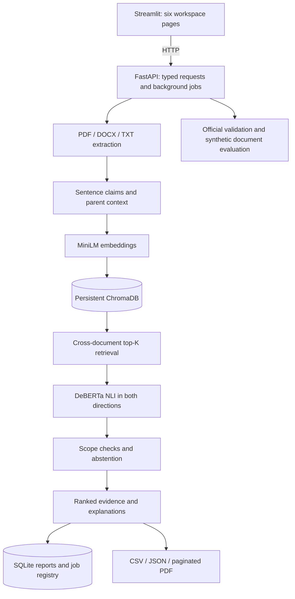

# DocuConflict AI

Intelligent Cross-Document Contradiction Detection Using Retrieval-Augmented Generation and Natural Language Inference.

## Abstract and problem statement

Policies, specifications and academic notices may contain mutually incompatible claims. Manual comparison is slow, while keyword search misses paraphrases. DocuConflict indexes individual claims, retrieves related claims across documents, and uses a pretrained NLI cross-encoder to distinguish contradiction, entailment and neutral relationships. All inference runs locally after initial downloads. This is a college mini-project with reproducible evaluation, not a claim of production-grade legal or factual verification.

## Objectives and proposed system

Upload PDF, DOCX and TXT files; preserve source evidence; reduce pair comparisons with embeddings; classify candidate pairs; abstain when context differs; export reports; measure classification, retrieval and end-to-end performance separately. Existing similarity-only systems conflate topical overlap with contradiction. Here similarity selects candidates and NLI evaluates their relationship.

## Architecture



The maintained LangChain core Document abstraction and text splitters bound unusually long claims; ordinary claims are sentence-sized. Parent paragraphs and PDF page numbers accompany claims. DOCX/TXT page numbers are unavailable. Content hashes deduplicate repeated uploads. SQLite persists document registry and job/report snapshots; Chroma persists vectors. A single background worker serializes inference; a lock protects document mutation during analysis. Run one Uvicorn worker.

## Technologies and models

Python 3.11 target (3.12 supported for local verification), FastAPI, Pydantic, Uvicorn, Streamlit, Plotly, Pandas, LangChain core/text splitters, ChromaDB, Sentence Transformers, Transformers, PyTorch, PyMuPDF, python-docx, Datasets and scikit-learn. Direct dependencies are pinned in requirements.txt. An installed environment freeze, when generated, records transitive packages on Windows; it is not an Ubuntu lockfile.

Embedding model: [all-MiniLM-L6-v2](https://huggingface.co/sentence-transformers/all-MiniLM-L6-v2). NLI model: [nli-deberta-v3-base](https://huggingface.co/cross-encoder/nli-deberta-v3-base). The loader reads semantic id2label from the checkpoint configuration and rejects generic/ambiguous labels. Softmax produces three probabilities. Bidirectional scores are averaged; disagreements abstain. The model is never silently replaced. DOCU_NLI_MODEL can explicitly select a different three-class checkpoint with semantic id2label.

RAG here means retrieving source evidence to ground classification and templated summaries. No generative API is required. NLI entailment is directional: a more specific claim can entail another without being equivalent. Agreement therefore means model support in the evaluated directions, not proof of complete equivalence.

## Ubuntu setup

Use a terminal with Python 3.11 installed. Copy this repository into the project directory if starting from downloaded source.

```bash
mkdir -p ~/docuconflict-ai
# Copy the repository contents into ~/docuconflict-ai, then:
cd ~/docuconflict-ai
python3.11 -m venv .venv
source .venv/bin/activate
python -m pip install --upgrade pip
# CPU wheels avoid unnecessary NVIDIA dependencies on Ubuntu:
python -m pip install torch==2.7.1 --index-url https://download.pytorch.org/whl/cpu
python -m pip install -r requirements.txt
cp .env.example .env
python -m scripts.download_models
python -m scripts.download_datasets --dataset multinli --split validation_matched --count 300
# Optional second validation domain / benchmark:
python -m scripts.download_datasets --dataset multinli --split validation_mismatched --count 300
python -m scripts.download_datasets --dataset snli --count 300
python -m scripts.generate_sample_documents
```

Initial installation and downloads require internet and several GB of disk space. CPU inference can take minutes. Runtime defaults to DOCU_OFFLINE=true and Hugging Face loaders use local_files_only. The download script explicitly enables online model loading for that process. Dataset evaluation reads saved JSON and never downloads automatically. Optionally set HF_HUB_OFFLINE=1 and HF_DATASETS_OFFLINE=1 after preparation for a strict offline demonstration. DOCU_TORCH_THREADS defaults to 4 to limit CPU thread overhead; adjust it for your hardware. Keep DOCU_DEVICE=cpu or explicitly choose cuda if your PyTorch installation supports it.

Start in two terminals from the project root:

```bash
bash run_backend.sh
# In another terminal:
bash run_frontend.sh
```

Open http://localhost:8501. Backend health: http://localhost:8000/health. Swagger: http://localhost:8000/docs. Stop each terminal with Ctrl+C. No Docker, paid API or cloud service is used. Bindings are localhost only; this application has no authentication and is intended for one local user.

## Optional Windows setup

```powershell
py -3.12 -m venv .venv
.\.venv\Scripts\python.exe -m pip install -r requirements.txt
Copy-Item .env.example .env
.\.venv\Scripts\python.exe -m scripts.download_models
.\.venv\Scripts\python.exe -m scripts.download_datasets --count 300
.\.venv\Scripts\python.exe -m scripts.generate_sample_documents
powershell -ExecutionPolicy Bypass -File run_backend.ps1
# In a second terminal:
powershell -ExecutionPolicy Bypass -File run_frontend.ps1
```

## ESE demonstration

1. Upload data/samples/demo_policy_a.docx and demo_policy_b.docx.
2. Open Contradiction Finder, select both, keep initial threshold 0.75 and top-K 5.
3. Run analysis. The progress panel polls background job state; click Refresh results on completion.
4. Inspect differing upload sizes and Friday-work rules, exact evidence and context. Predictions come from the real model and are not guaranteed to match every synthetic label.
5. Inspect agreements, neutral results and Needs Review. Try different-year fee policies and different-department budgets in data/benchmarks.
6. Upload multipage benchmark PDFs to demonstrate page references and embedded conflicts.
7. Ask a document question, then export CSV, JSON and PDF.
8. Run the sentence and document benchmarks separately.

The synthetic benchmark generator creates 18 explicitly synthetic cases: numerical limits, negation, agreement, years, unrelated topics, paraphrased conflict, entities, refunds, compatible deadlines, more-specific requirements, conditions, missing information, examination schedules, product storage, company rules, different dates, multipage PDFs and three-document comparison. Ground truth is manually authored in data/benchmarks/ground_truth.json. It is never an input to inference. Identical byte uploads deduplicate intentionally.

## Tests

```bash
python -m pytest -q
python -m scripts.check_startup
# Opt-in downloaded-model integration:
DOCU_TEST_MODELS=1 python -m pytest -q -m models
```

PowerShell: `$env:DOCU_TEST_MODELS="1"; .\.venv\Scripts\python.exe -m pytest -q -m models`.
Tests isolate their database in a temporary folder. API wiring tests explicitly substitute embeddings and NLI outputs to test integration without large weights; those tests do not establish model accuracy. The models test exercises actual embeddings, Chroma retrieval, softmax inference and the contradiction engine. See VERIFICATION.md for checks actually executed in this workspace.

## Evaluation methodology

[MultiNLI](https://huggingface.co/datasets/nyu-mll/multi_nli) official validation_matched and validation_mismatched splits are used, with actual ClassLabel mapping and fixed seed 42. Streaming buffer shuffle avoids loading training data, excludes invalid labels, and selects approximately balanced 300?1000 examples. The saved JSON preserves premise, hypothesis, original numeric label, semantic label, split and seed. [SNLI](https://huggingface.co/datasets/stanfordnlp/snli) validation is optional. Neither benchmark is used to train this project. The pretrained model was trained on SNLI/MultiNLI training data, so these benchmarks are in-domain evaluations, not evidence of generalization to policies.

```bash
python -m scripts.run_evaluation --dataset multinli --count 300
python -m scripts.run_evaluation --dataset documents
```

Sentence evaluation measures accuracy, macro precision/recall/F1, per-class metrics and a confusion matrix; it retains every prediction and misclassification. Document evaluation uses isolated ephemeral Chroma collections and reports pooled gold-pair Recall@K, positive-case candidate success rate, candidate count, contradiction precision/recall/F1, false positives, false negatives and runtime for K=3,5,10. A candidate success means at least one expected pair was retrieved in a positive case. A gold pair counts as retrieved when either query direction retrieves its partner. Evaluation writes JSON, CSV and standalone offline HTML charts under data/results. Tiny one-claim cases may make K=3,5,10 indistinguishable; the multipage case adds distractors, but this remains a small demonstration benchmark.

Threshold 0.75 is an initial candidate value, not tuned or optimal. Run `python -m scripts.tune_threshold` on the separate 12-pair synthetic data/development/pairs.json set. It evaluates a threshold grid and saves development_threshold.json; apply the selected value explicitly in the UI or with run_evaluation --threshold, freeze it, then evaluate once on the held-out benchmark. The small synthetic development set is only a demonstration of tuning methodology. Do not use this synthetic benchmark for threshold selection and final reporting simultaneously.

## API

GET /health; POST /documents/upload (multipart files); GET /documents; DELETE /documents/{id}; DELETE /documents; POST /analysis/compare; GET /analysis/results/{id}; GET /analysis; POST /ask; POST /evaluation/run; GET /evaluation/results/{id}; GET /reports/{id}?format=csv|json|pdf. Typed payloads and responses are documented in Swagger. Jobs persist status, progress, errors and full results. Interrupted jobs are marked failed at server startup. Analysis snapshots remain after document deletion; clear/remove data/results and registry only when you intentionally want to destroy historical reports.

## Results and screenshots

Actual local verification completed: **17 tests passed**, both servers started successfully, and real-model upload-to-report integration passed. On 300 balanced MultiNLI validation_matched examples (seed 42), measured accuracy was **86.67%**, macro precision **0.866991**, macro recall **0.866667**, and macro F1 **0.866814**. The 18-case synthetic document regression benchmark found 11/11 conflicts after conservative scope fixes; its revised precision/recall/F1 are 1.0, but its initial four false positives informed debugging, so it is **not independent held-out evidence**. See [VERIFICATION.md](VERIFICATION.md) for initial/revised measurements and limitations, and [EVALUATION_RESULTS.json](EVALUATION_RESULTS.json) for the actual result summary. Capture screenshots from the running Dashboard, comparison cards, evaluation confusion matrix and report download page for the college submission; no fabricated screenshot is supplied.

## Limitations and future enhancements

English text only; no OCR, charts/images or equation reasoning. Segmentation uses punctuation heuristics, may mishandle abbreviations, and fragments long claims. DOCX tables lose some layout. Scope verification is deliberately narrow: explicit years, a few entity identifiers, conditional phrases, zero shared content terms, compatible lower-bound phrasing and split claims trigger review; it does not solve coreference, general named entities, all date formats, units or temporal reasoning. The lexical guard can abstain on legitimate paraphrases with no shared words. The NLI model can still misclassify different dates and compatible numerical bounds. Shared parent passages are shown and checked heuristically, not fed through a second contextual NLI model. Confidence scores are uncalibrated. More-specific or omitted context can produce directional disagreement. The QA page retrieves and summarizes evidence; it is not a generative chatbot. Upload indexing is synchronous with a spinner; analysis/evaluation use background jobs. File and candidate limits bound ordinary workloads, but decompression bombs and hostile documents require stronger isolation before public deployment. No accuracy claim, locally generated LLM explanation or exhaustive baseline is included. Future work: OCR, stronger entity/time normalization, development-only calibration, multilingual models, retrieval expansion and human review annotations.

## Viva preparation

- **RAG:** retrieve relevant source passages to ground downstream model output.
- **ChromaDB:** local persistent approximate vector search with source metadata and filters.
- **Embeddings:** dense numerical representations of text meaning.
- **Semantic similarity:** closeness in embedding space; it does not establish truth or conflict.
- **NLI:** classify a premise/hypothesis pair as entailment, contradiction or neutral.
- **Contradiction versus neutral:** incompatible assertions versus insufficient support or conflict.
- **Cross-encoder:** jointly attends to both claims for richer interaction than separate embeddings; costs more per pair.
- **LangChain:** Document objects and maintained text splitters retain metadata and bound passages.
- **Document difficulty:** retrieval can miss pairs; context, dates, entities and conditions affect compatibility.
- **False positives:** scope checks, bidirectional inference, thresholds and explicit abstention reduce them without guaranteeing elimination.
- **Accuracy:** correct three-class predictions divided by evaluated examples; report macro-F1 too. End-to-end contradiction precision/recall measures a different task.
- **Limitations:** imperfect retrieval, NLI domain shift, heuristic context and no OCR or external factual validation.
